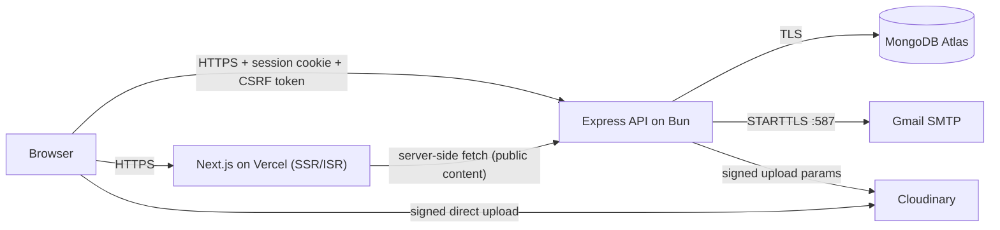
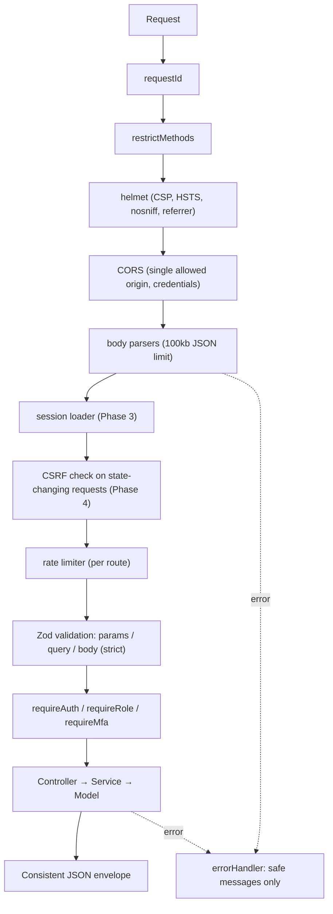

# Dezaakir — Architecture

## 1. Overview

Dezaakir is a personal developer portfolio and technology publishing platform. It's a **Bun monorepo** with two independently deployable apps:

| App | Stack | Hosting |
|---|---|---|
| `frontend/` | Next.js (App Router), TypeScript strict, Tailwind CSS v4, Framer Motion, Lucide, React Hook Form, Zod, TipTap | Vercel |
| `backend/` | Bun runtime, Express 5, TypeScript strict (ES Modules only), Mongoose, Zod, Nodemailer | Secure Node/Bun host (Railway / Render / Fly.io) |
| Database | MongoDB Atlas (TLS, auth, IP allow-list, least-privilege user) | Atlas |
| Media | Cloudinary (signed uploads only) | Cloudinary |
| Email | Gmail SMTP via Nodemailer + Gmail App Password | Google |



## 2. Why Bun

- One toolchain for package management, workspaces, running TypeScript directly, watch mode and testing (`bun test`).
- `Bun.password` gives **native Argon2id** hashing, so there's no native `argon2` addon to compile.
- `Bun.CryptoHasher` / `node:crypto` provide HMAC-SHA256 for OTP and token hashing.

## 3. Repository layout

```
dezaakir-portfolio/
├── package.json            # Bun workspaces + root scripts
├── bun.lock
├── frontend/
│   ├── app/                # Routes (public, auth, account, admin)
│   ├── components/         # Reusable UI (ui/, layout/, blog/, admin/)
│   ├── features/           # Feature modules (auth, blog, projects, admin)
│   ├── hooks/
│   ├── lib/                # site config, api client, utils
│   ├── services/           # Typed API calls
│   ├── types/
│   └── public/
├── backend/
│   ├── bunfig.toml         # test preload
│   └── src/
│       ├── config/         # env validation, db connection
│       ├── controllers/    # HTTP layer (thin)
│       ├── middleware/     # auth, rbac, csrf, validation, rate limit, errors
│       ├── models/         # Mongoose schemas (12 models)
│       ├── routes/
│       ├── services/       # business logic (auth, otp, mail, media…)
│       ├── validators/     # Zod schemas (strict: unknown keys rejected)
│       ├── utils/          # logger, AppError, response envelope, crypto
│       ├── scripts/        # CLI (create-admin, backup helpers)
│       └── tests/
└── docs/
```

## 4. Backend request pipeline



**Response envelope:**

```json
{ "success": true, "data": {}, "meta": { "page": 1, "limit": 10, "total": 42, "totalPages": 5 } }
{ "success": false, "error": { "code": "VALIDATION_ERROR", "message": "…", "details": [] } }
```

## 5. Authentication model

- **Server-side sessions** live in a MongoDB `Session` collection. The cookie holds only a random 256-bit session id, and the database stores just its SHA-256 hash, so a database leak can't be replayed as sessions.
- Cookie: `HttpOnly`, `Secure` (production), `SameSite=Lax`, `Path=/`, and a bounded lifetime with idle timeout.
- **CSRF:** synchronizer token tied to the session plus `Origin`/`Referer` validation. We don't rely on SameSite alone.
- **Passwords:** Argon2id via `Bun.password`.
- **Email OTP:** a 6-digit code from a CSPRNG. Only `HMAC-SHA256(OTP_HMAC_SECRET, code)` is stored. Codes expire after 10 minutes, have a 60-second resend cooldown, allow at most 5 attempts, are single-use, and are removed by a TTL index.
- **Admin MFA:** TOTP (RFC 6238). The secret is encrypted at rest with AES-256-GCM (`MFA_ENCRYPTION_KEY`), and hashed recovery codes are available as a fallback.
- **Admin bootstrap:** a CLI command (`bun run create-admin`) creates the first admin. Public registration always creates `USER`.

## 6. Frontend ↔ backend deployment topology

To keep `SameSite=Lax` cookies first-party, serve the API on a **subdomain of the same site** (e.g. `dezaakir.com` + `api.dezaakir.com`). Browser calls use `credentials: "include"`. Public pages are rendered on the server with ISR and revalidated on publish.

## 7. Design system

There are only two colors: **Navy `#0B1628`** and **White `#FFFFFF`**. Tailwind's default palette is removed in `globals.css` (`--color-*: initial`), so no other color class exists. Hierarchy comes from opacity (`white/5 … white/90`, `navy/80`). Typography uses Geist Sans and Geist Mono, bundled locally with no external font requests.

## 8. Database Architecture (Phase 2)

All 12 Mongoose models live in `backend/src/models/`:
1. **User**: `name`, normalized `email` (unique), `passwordHash` (`select: false`), `role` (`USER` | `ADMIN`), `emailVerified`, `status` (`PENDING` | `ACTIVE` | `SUSPENDED`), lockout counters, encrypted TOTP `mfa` subdocument, and a 7-day partial TTL index on unverified `PENDING` accounts.
2. **Session**: server-side sessions storing only `tokenHash` and `csrfTokenHash` (`select: false`), `mfaVerified`, `ip`, `userAgent`, `lastSeenAt`, `expiresAt` (TTL index), `revokedAt`.
3. **EmailVerification**: one active OTP per user (`unique` index on `user`), storing only `codeHash` (`select: false`), `attempts`, `lastSentAt`, `expiresAt` (10-minute TTL index).
4. **PasswordResetToken**: single-use reset tokens storing only `tokenHash` (`select: false`), `expiresAt` (30-minute TTL index), `usedAt`.
5. **Blog**: `title`, `slug` (unique), `excerpt`, sanitized `content`, `contentText` (weighted full-text index), `coverImage`, `author`, `category`, `tags`, `status` (`DRAFT` | `SCHEDULED` | `PUBLISHED`), `featured`, `readingTime`, SEO fields, `publishedAt`, and `Blog.publicFilter()`.
6. **Project**: `title`, `slug` (unique), `summary`, sanitized `description`, `coverImage`, `images`, `technologies`, HTTPS-validated `githubUrl`/`liveUrl`, `category`, `featured`, `status` (`DRAFT` | `PUBLISHED`), `order`, SEO fields, and `Project.publicFilter()`.
7. **Category**: `name`, `slug`, `type` (`BLOG` | `PROJECT`), compound unique index `(type, slug)`.
8. **Tag**: `name`, `slug` (unique).
9. **ContactMessage**: `name`, `email`, CR/LF-free `subject`, `message`, `status` (`NEW` | `READ` | `ARCHIVED`), `ipHash` (`select: false`).
10. **Media**: Cloudinary asset metadata (`publicId` unique, `url`, `format`, `bytes`, dimensions, `alt`, `folder`, `uploadedBy`).
11. **AuditLog**: append-only security/admin event log (updates blocked by pre-hooks) with a 365-day TTL index.
12. **SiteSettings**: race-safe singleton (`key = "site"`) storing biography, skills, experience, education, social links, CV URL, and SEO defaults.

## 9. Phase roadmap

| # | Phase | Status |
|---|---|---|
| 1 | Architecture & project setup | ✅ Complete |
| 2 | MongoDB models & connection | ✅ Complete |
| 3 | Authentication & Gmail OTP | ✅ Complete |
| 4 | Security middleware & API protection | ⏳ Next |
| 5 | Public frontend | — |
| 6 | Blog management | — |
| 7 | Project management | — |
| 8 | Admin dashboard | — |
| 9 | Testing & security audit | — |
| 10 | Production deployment | — |
